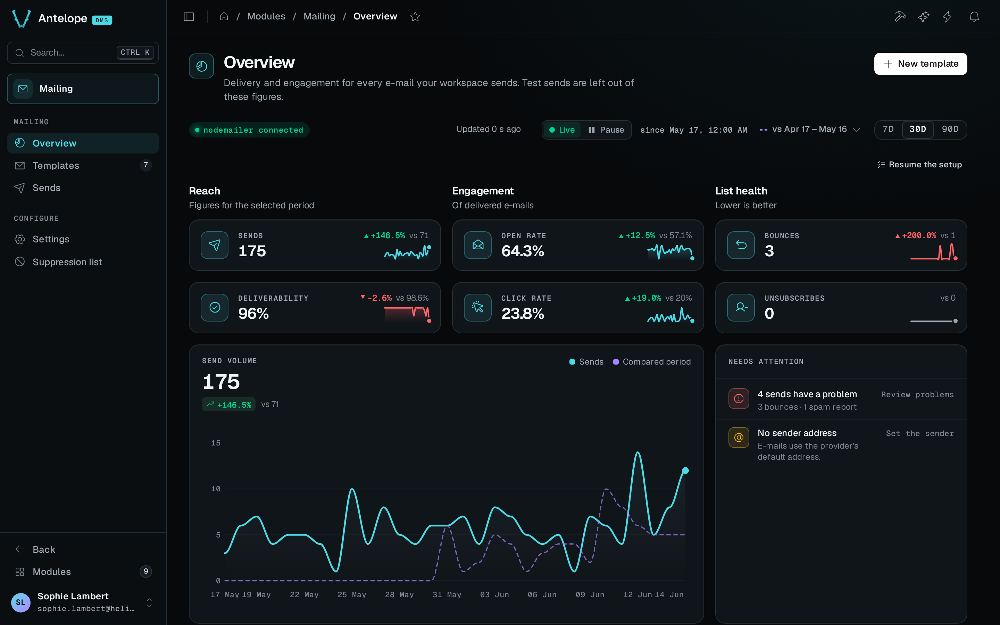

<a href="https://github.com/AntelopeJS/dms"></a>

<div align="center">

# `@antelopejs/dms-mailing`

<a href="https://www.npmjs.com/package/@antelopejs/dms-mailing"></a> <a href="./LICENSE"></a> <a href="https://discord.gg/g4pFt6eXqu"></a> <a href="https://dms.antelopejs.com/docs/modules/mailing"></a> <a href="https://github.com/AntelopeJS/dms"></a>

**Design e-mail templates in a block editor, send them from your code, an automation or the dashboard, and track delivery.**

[Try it in the live demo](https://dms-demo.antelopejs.com/modules/mailing) · [Documentation](https://dms.antelopejs.com/docs/modules/mailing) · [All modules](https://github.com/AntelopeJS/dms#modules)

</div>



## What it does

- Designs e-mail templates in a block editor, with typed variables, conditions, lists and live test data.
- Keeps edits in draft and publishes them as versions, in several locales.
- Sends a template by its slug from your code, an automation or the dashboard, through any `@antelopejs/interface-email` provider.
- Logs every send with the provider's timeline, and turns delivery, open and click events into an overview.
- Protects your sender reputation with a suppression list fed by hard bounces, spam complaints and unsubscriptions.

## Install

Run the AntelopeJS CLI from the root of a project that already loads `@antelopejs/dms`. Add an e-mail provider if the project has none:

```bash
ajs project modules add @antelopejs/dms-mailing
ajs project modules add @antelopejs/nodemailer
```

## Quick start

In development, send to a throwaway Ethereal inbox:

```ts fragment
// antelope.config.ts
nodemailer: {
  source: { type: "package", package: "@antelopejs/nodemailer", version: ">=0.0.6 <1.0.0" },
  config: { ethereal: true },
},
```

Restart the backend, then the frontend, and open **Modules › Mailing** (`/modules/mailing/overview`). On a workspace with no templates, create the **Order confirmation** template from the starter gallery and publish it. Its slug is `order-confirmed`. The **New template** dialog derives the slug from the name instead, so it gives `order-confirmation`. Check the slug before you send. Any module can then send it through [`@antelopejs/interface-dms-mailing`](./packages/interface-dms-mailing):

```ts fragment
import { SendTemplate } from "@antelopejs/interface-dms-mailing";

await SendTemplate("order-confirmed", {
  tenantId,
  to: "sofie@example.com",
  variables: {
    customer: { firstName: "Sofie" },
    order: {
      number: "#10482",
      total: { value: 4800, currency: "EUR" },
      lines: [{ name: "Linen shirt", total: { value: 4800, currency: "EUR" } }],
      url: "https://example.com/orders/10482",
    },
  },
});
```

## Compatibility

The [module README compatibility block](packages/dms-mailing/README.md#compatibility) lists the `@antelopejs/*` ranges the module supports. The module also needs:

- A DMS backend in a release that implements the `@antelopejs/interface-dms` range of that block.
- The `@antelopejs/dms-frontend` renderer in the range of `engines["@antelopejs/dms-frontend"]` in `packages/dms-mailing/frontend-vue/package.json`. The `ajs dms` CLI refuses to build the module with a renderer outside that range.
- A database module that enforces unique indexes, such as `@antelopejs/mongodb` or `@antelopejs/postgres`.
- An e-mail provider, which is an `@antelopejs/interface-email` implementation such as `@antelopejs/nodemailer`.

## Packages

| Package | Directory | Role |
| --- | --- | --- |
| [`@antelopejs/dms-mailing`](https://www.npmjs.com/package/@antelopejs/dms-mailing) | [`packages/dms-mailing`](./packages/dms-mailing) | The module: template library, block editor, send log and delivery metrics. |
| [`@antelopejs/interface-dms-mailing`](https://www.npmjs.com/package/@antelopejs/interface-dms-mailing) | [`packages/interface-dms-mailing`](./packages/interface-dms-mailing) | The interface other modules call: `SendTemplate`, `RecordEmailEvent`, `DeclareTemplate`, `DeclareTemplateCategory`, `DeclareSender` and `ImportSends`. |

## Documentation

- [Consumer reference](./packages/interface-dms-mailing/docs/1.index.md)
- [Introduction](https://dms.antelopejs.com/docs/modules/mailing/introduction)
- [Installation](https://dms.antelopejs.com/docs/modules/mailing/installation)
- [Configuration](https://dms.antelopejs.com/docs/modules/mailing/configuration)
- [Usage](https://dms.antelopejs.com/docs/modules/mailing/usage/overview)
- [Extending](https://dms.antelopejs.com/docs/modules/mailing/extending): sending from code, templates as code, importing past sends, provider events and webhooks, automations
- [FAQ](https://dms.antelopejs.com/docs/modules/mailing/faq)

The guide's sources live in [`packages/dms-mailing/docs`](./packages/dms-mailing/docs). The module ships the `dms-mailing` Claude Code skill in [`packages/dms-mailing/skills`](./packages/dms-mailing/skills), declared under `antelopeJs.skills`.

## Contributing

Read [CONTRIBUTING.md](./CONTRIBUTING.md) before opening a pull request. Start at the repository root. One `pnpm install` there installs the shared tooling and the backend, interface and Vue layer dependencies, and each package keeps its own lockfile. The playground installs on its own. It uses MongoDB at `mongodb://localhost:27017` (set `MONGO_URL` to change it) and sends to Ethereal, or to a local SMTP server when `SMTP_PORT` is set.

```bash
pnpm install
pnpm --dir packages/interface-dms-mailing build   # declarations needed by the backend
cd packages/dms-mailing
pnpm --dir playground install --ignore-workspace
pnpm dev            # backend on http://localhost:5010
pnpm frontend:dev   # dashboard on http://localhost:3001, in a second terminal
pnpm --dir ../.. run checks   # typecheck, lint, format, knip, layer tests, size, suppressions, sync
pnpm test           # backend (unit and integration), then the frontend layer
```

<details>
<summary>Repository notes</summary>

- Every text the backend declares uses the `$key` convention. The frontend resolves a string that starts with `$` against the i18n catalogs. Add keys to `frontend-vue/i18n/locales/mailing-en-GB.json` and to `mailing-fr-FR.json`.
- Every read goes through the DMS `useApiData`. The server render reads what a page shows and hands it to the browser. A drawer, a dialog, a preview frame or the editor reads its data when it opens, through the on-demand reads of `useMailingReads` (`immediate: false`). Writes go through `useMailingApi`.
- The module implements the interface, so it caps its interface range below the next minor. The `@antelopejs/interface-dms-mailing` row of the [module README compatibility block](packages/dms-mailing/README.md#compatibility) shows that range. Inside the workspace, the range resolves to the sibling package. Release the interface first (**Release DMS mailing interface**), then the module (**Release DMS mailing module**). The module workflow refuses to run until the interface version at the floor of its range resolves on npm.
- `packages/dms-mailing/docs/design/design-v2-grill-me.md` and its second part, `design-v2-grill-me-2.md`, record the decisions behind the v2 redesign. The DMS site does not publish them.

</details>

## Part of AntelopeJS DMS

This module installs into [AntelopeJS DMS](https://github.com/AntelopeJS/dms), the open-source back office. Every module adds its pages to the same dashboard, behind the same sign-in and roles.

<!-- antelopejs-dms-modules:start -->

| Module                                                           | What it adds                                                                             |
| ---------------------------------------------------------------- | ---------------------------------------------------------------------------------------- |
| [`dms-builder`](https://github.com/AntelopeJS/dms-builder)       | Edit pages, tables and data sources by clicking, as TypeScript that compiles             |
| [`dms-ai`](https://github.com/AntelopeJS/dms-ai)                 | An assistant chat in the dashboard, on your own Claude Code or Codex                     |
| [`dms-database`](https://github.com/AntelopeJS/dms-database)     | Schemas, relation diagrams, a data browser and a query console                           |
| [`dms-api`](https://github.com/AntelopeJS/dms-api)               | API health, request logs, per-route statistics and a request tester                      |
| [`dms-automation`](https://github.com/AntelopeJS/dms-automation) | Node-graph automations on schedules, webhooks and DMS events, with a trace for every run |
| [`dms-mailing`](https://github.com/AntelopeJS/dms-mailing)       | E-mail templates in a block editor, versions, a send log and delivery metrics            |
| [`dms-lang`](https://github.com/AntelopeJS/dms-lang)             | Translation coverage, a translation matrix and a translation queue                       |
| [`dms-media`](https://github.com/AntelopeJS/dms-media)           | A media library with folders, per-folder permissions, image sizes and light editing      |
| [`dms-saas`](https://github.com/AntelopeJS/dms-saas)             | Self-service sign-up, plans that gate features, and Stripe billing                       |
| [`dms-marketing`](https://github.com/AntelopeJS/dms-marketing)   | Traffic, conversion funnels with A/B splits and click heatmaps, without cookies          |
| [`dms-frontend`](https://github.com/AntelopeJS/dms-frontend)     | The `ajs dms` CLI, the Vue renderer and the SDK every frontend module builds on          |

<!-- antelopejs-dms-modules:end -->

## License

[Apache-2.0](./LICENSE)
