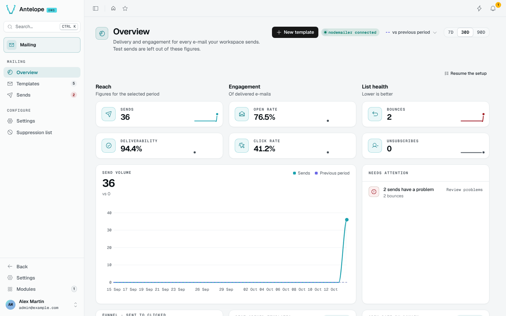

<div align="center">

# @antelopejs/dms-mailing

<a href="https://www.npmjs.com/package/@antelopejs/dms-mailing"></a>
<a href="./LICENSE"></a>
<a href="https://discord.gg/sjK28QHrA7"></a>
<a href="https://dms.antelopejs.com/docs/modules/mailing"></a>

E-mail templates, sends and delivery metrics for the AntelopeJS DMS.

</div>



## What it does

- Designs e-mail templates in a block editor, with typed variables, conditions, lists and live test data.
- Keeps edits in draft and publishes them as versions, in several locales.
- Sends a template by its slug from your code, an automation or the dashboard, through any `@antelopejs/interface-email` provider.
- Logs every send with the provider's timeline, and turns delivery, open and click events into an overview.
- Protects your sender reputation with a suppression list fed by bounces, complaints and unsubscriptions.

## Install

Run the AntelopeJS CLI from the root of a project that already loads `@antelopejs/dms`, and add an e-mail provider if the project has none:

```bash
ajs project modules add @antelopejs/dms-mailing
ajs project modules add @antelopejs/nodemailer
```

## Quick start

In development, send to a throwaway Ethereal inbox:

```ts
// antelope.config.ts
nodemailer: {
  source: { type: "package", package: "@antelopejs/nodemailer", version: ">=0.0.5 <1.0.0" },
  config: { ethereal: true },
},
```

Restart the backend, then the frontend, and open **Modules › Mailing** (`/modules/mailing/overview`). Create a template from a starter such as **Order confirmation**, publish it, then send it from any module through [`@antelopejs/interface-dms-mailing`](./packages/interface-dms-mailing):

```ts
import { SendTemplate } from "@antelopejs/interface-dms-mailing";

await SendTemplate("order-confirmation", {
  tenantId,
  to: "sofie@example.com",
  variables: { order: { total: "48.00" } },
});
```

## Compatibility

| Package | Version |
| --- | --- |
| `@antelopejs/dms` | `>=0.9.0 <1.0.0` |
| `@antelopejs/interface-dms` | `>=0.7.1 <1.0.0` |
| `@antelopejs/dms-frontend` (renderer, playground range) | `>=0.6.1 <0.7.0` |
| `@antelopejs/interface-dms-mailing` | `>=0.7.0 <0.8.0` |
| E-mail provider | an `@antelopejs/interface-email` implementation, such as `@antelopejs/nodemailer` |

On DMS 0.8, use `@antelopejs/dms-mailing` 0.4.

## Packages

| Package | Directory | Role |
| --- | --- | --- |
| [`@antelopejs/dms-mailing`](https://www.npmjs.com/package/@antelopejs/dms-mailing) | [`packages/dms-mailing`](./packages/dms-mailing) | The module: template library, block editor, send log and delivery metrics. |
| [`@antelopejs/interface-dms-mailing`](https://www.npmjs.com/package/@antelopejs/interface-dms-mailing) | [`packages/interface-dms-mailing`](./packages/interface-dms-mailing) | The interface other modules call: `SendTemplate` and `RecordEmailEvent`. |

## Documentation

- [Consumer reference](./packages/interface-dms-mailing/docs/1.index.md)
- [Introduction](https://dms.antelopejs.com/docs/modules/mailing/introduction)
- [Installation](https://dms.antelopejs.com/docs/modules/mailing/installation)
- [Configuration](https://dms.antelopejs.com/docs/modules/mailing/configuration)
- [Usage](https://dms.antelopejs.com/docs/modules/mailing/usage/overview)
- [Extending](https://dms.antelopejs.com/docs/modules/mailing/extending): sending from code, provider events and webhooks, automations
- [FAQ](https://dms.antelopejs.com/docs/modules/mailing/faq)

The guide's sources live in [`packages/dms-mailing/docs`](./packages/dms-mailing/docs). The module ships the `dms-mailing` Claude Code skill in [`packages/dms-mailing/skills`](./packages/dms-mailing/skills), declared under `antelopeJs.skills`.

## Contributing

Read [CONTRIBUTING.md](./CONTRIBUTING.md) before opening a pull request. Start at the repository root: one install covers the shared tooling, backend, interface and Vue development dependencies, retaining each project's lockfile. The playground remains independent. It uses MongoDB at `mongodb://localhost:27017` (set `MONGO_URL` to change it) and sends to Ethereal, or to a local SMTP server when `SMTP_PORT` is set.

```bash
pnpm install
pnpm --dir packages/interface-dms-mailing build   # declarations needed by the backend
cd packages/dms-mailing
pnpm --dir playground install --ignore-workspace
pnpm dev            # backend on http://localhost:5010
pnpm frontend:dev   # dashboard on http://localhost:3001, in a second terminal
pnpm lint           # oxlint, oxfmt and the frontend's ESLint
pnpm typecheck
pnpm knip
pnpm test           # backend (unit and integration), then the frontend layer
```

<details>
<summary>Repository notes</summary>

- Every backend-declared text uses the `$key` convention: a string starting with `$` is resolved against the i18n catalogs by the frontend. Add keys to `frontend-vue/i18n/locales/mailing-en-GB.json` and its French counterpart.
- Every read goes through the DMS's `useApiData`: what a page renders is read by the server render and handed to the browser; what a drawer, a dialog, a preview frame or the editor shows is read when it opens (`immediate: false`, `useMailingReads`). Writes stay on `useMailingApi`.
- The module implements the interface, so it caps its range below the next minor (`>=0.7.0 <0.8.0`); inside the workspace that range resolves to the sibling package. Release the interface first (**Release DMS mailing interface**), then the module (**Release DMS mailing module**), which refuses to run until the interface version its range is floored at resolves on npm.
- `docs/design/design-v2-grill-me.md` records the decisions behind the v2 redesign.

</details>

## License

[Apache-2.0](./LICENSE)
