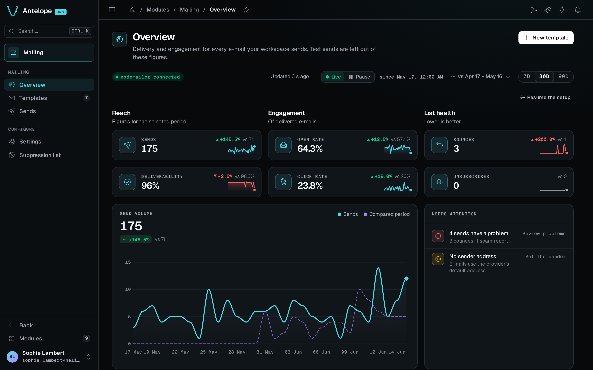

<div align="center">

# `@antelopejs/dms-mailing`

<a href="https://www.npmjs.com/package/@antelopejs/dms-mailing"></a>
<a href="./LICENSE"></a>
<a href="https://discord.gg/g4pFt6eXqu"></a>
<a href="https://dms.antelopejs.com/docs/modules/mailing"></a>

E-mail templates, sends and delivery metrics for the AntelopeJS DMS.

</div>



## What it does

- Designs e-mail templates in a block editor, with typed variables, conditions, lists and live test data.
- Keeps edits in draft and publishes them as versions, in several locales.
- Sends a template by its slug from your code, an automation or the dashboard, through any `@antelopejs/interface-email` provider.
- Logs every send with the provider's timeline, and turns delivery, open and click events into an overview.
- Protects your sender reputation with a suppression list fed by hard bounces, spam complaints and unsubscriptions.

## Install

Run the AntelopeJS CLI from the root of a project that already loads `@antelopejs/dms`. Add an e-mail provider if the project has none:

```bash
ajs project modules add @antelopejs/dms-mailing
ajs project modules add @antelopejs/nodemailer
```

## Quick start

In development, send to a throwaway Ethereal inbox:

```ts fragment
// antelope.config.ts
nodemailer: {
  source: { type: "package", package: "@antelopejs/nodemailer", version: ">=0.0.6 <1.0.0" },
  config: { ethereal: true },
},
```

Restart the backend, then the frontend, and open **Modules › Mailing** (`/modules/mailing/overview`). On a workspace with no templates, create the **Order confirmation** template from the starter gallery and publish it. Its slug is `order-confirmed`. The **New template** dialog derives the slug from the name instead, so it gives `order-confirmation`. Check the slug before you send. Any module can then send it through [`@antelopejs/interface-dms-mailing`](https://github.com/AntelopeJS/dms-mailing/tree/main/packages/interface-dms-mailing):

```ts fragment
import { SendTemplate } from "@antelopejs/interface-dms-mailing";

await SendTemplate("order-confirmed", {
  tenantId,
  to: "sofie@example.com",
  variables: {
    customer: { firstName: "Sofie" },
    order: {
      number: "#10482",
      total: { value: 4800, currency: "EUR" },
      lines: [{ name: "Linen shirt", total: { value: 4800, currency: "EUR" } }],
      url: "https://example.com/orders/10482",
    },
  },
});
```

## Compatibility

<!-- antelopejs-docs-compat:start -->

| Package                                     | Supported                                                                       | Tested with                                                                     |
| ------------------------------------------- | ------------------------------------------------------------------------------- | ------------------------------------------------------------------------------- |
| `@antelopejs/interface-api`                 | `file:../../.campaign/tgz/antelopejs-interface-api-f2a99b5.tgz`                 | `file:../../.campaign/tgz/antelopejs-interface-api-f2a99b5.tgz`                 |
| `@antelopejs/interface-api-util`            | `file:../../.campaign/tgz/antelopejs-interface-api-util-639f38b.tgz`            | `file:../../.campaign/tgz/antelopejs-interface-api-util-639f38b.tgz`            |
| `@antelopejs/interface-core`                | `file:../../.campaign/tgz/antelopejs-interface-core-f7df541.tgz`                | `file:../../.campaign/tgz/antelopejs-interface-core-f7df541.tgz`                |
| `@antelopejs/interface-data-api`            | `file:../../.campaign/tgz/antelopejs-interface-data-api-d8a868f.tgz`            | `file:../../.campaign/tgz/antelopejs-interface-data-api-d8a868f.tgz`            |
| `@antelopejs/interface-database`            | `>=0.3.0 <1.0.0`                                                                | `0.3.0`                                                                         |
| `@antelopejs/interface-database-decorators` | `file:../../.campaign/tgz/antelopejs-interface-database-decorators-e79a62b.tgz` | `file:../../.campaign/tgz/antelopejs-interface-database-decorators-e79a62b.tgz` |
| `@antelopejs/interface-dms`                 | `file:../../.campaign/tgz/antelopejs-interface-dms-14e671d.tgz`                 | `file:../../.campaign/tgz/antelopejs-interface-dms-14e671d.tgz`                 |
| `@antelopejs/interface-dms-automation`      | `file:../../.campaign/tgz/antelopejs-interface-dms-automation-b4bc5d2.tgz`      | `file:../../.campaign/tgz/antelopejs-interface-dms-automation-b4bc5d2.tgz`      |
| `@antelopejs/interface-dms-mailing`         | `>=0.10.0 <0.11.0`                                                              | `0.10.0`                                                                        |
| `@antelopejs/interface-email`               | `>=0.0.6 <1.0.0`                                                                | `0.0.6`                                                                         |

<!-- antelopejs-docs-compat:end -->

The module also needs:

- A DMS backend in a release that implements the `@antelopejs/interface-dms` range in the table above.
- The `@antelopejs/dms-frontend` renderer in the range of `engines["@antelopejs/dms-frontend"]` in `frontend-vue/package.json`. The `ajs dms` CLI refuses to build the module with a renderer outside that range.
- A database module that enforces unique indexes, such as `@antelopejs/mongodb` or `@antelopejs/postgres`.
- An e-mail provider, which is an `@antelopejs/interface-email` implementation such as `@antelopejs/nodemailer`.

## Slugs

Sends find a template by its slug, so a slug belongs to one template per workspace. The `slug` index of the `mailing_templates` table is unique. Creating or duplicating a template on a slug another template holds, even in a race, answers `409` with `$dms_mailing.errors.duplicate_slug` and creates nothing. Deleting a template frees its slug. The unique index needs a database module that enforces unique indexes, such as `@antelopejs/mongodb` or `@antelopejs/postgres`. RethinkDB refuses the schema.

## Documentation

- [Introduction](https://dms.antelopejs.com/docs/modules/mailing/introduction)
- [Installation](https://dms.antelopejs.com/docs/modules/mailing/installation)
- [Configuration](https://dms.antelopejs.com/docs/modules/mailing/configuration)
- [Usage](https://dms.antelopejs.com/docs/modules/mailing/usage/overview)
- [Extending](https://dms.antelopejs.com/docs/modules/mailing/extending): sending from code, templates as code, importing past sends, provider events and webhooks, automations
- [FAQ](https://dms.antelopejs.com/docs/modules/mailing/faq)

The guide's sources live in [`packages/dms-mailing/docs`](https://github.com/AntelopeJS/dms-mailing/tree/main/packages/dms-mailing/docs). The module ships the `dms-mailing` Claude Code skill in [`packages/dms-mailing/skills`](https://github.com/AntelopeJS/dms-mailing/tree/main/packages/dms-mailing/skills), declared under `antelopeJs.skills`.

## Contributing

This package lives in the [`AntelopeJS/dms-mailing`](https://github.com/AntelopeJS/dms-mailing) pnpm workspace, next to `@antelopejs/interface-dms-mailing`. Read [CONTRIBUTING.md](https://github.com/AntelopeJS/dms-mailing/blob/main/CONTRIBUTING.md) and the [repository README](https://github.com/AntelopeJS/dms-mailing#contributing) for the development commands.

## License

[Apache-2.0](./LICENSE)
