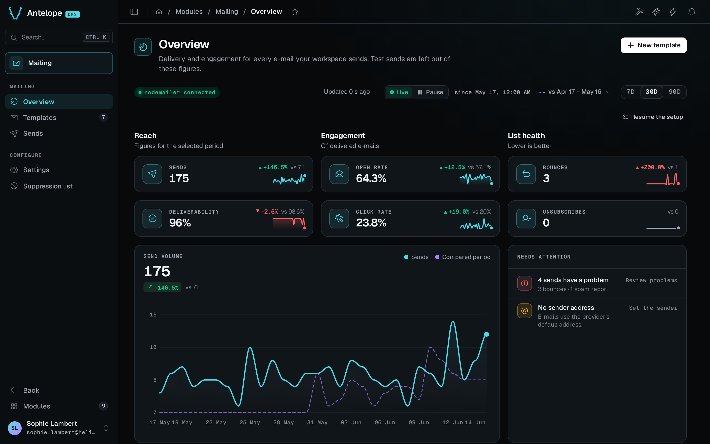

`@antelopejs/dms-mailing` gives your workspace a home for its e-mails. You design templates in a block editor, publish them as versions, and your code sends them by slug. Every send lands in a log with what the provider reported back, and an overview turns those events into delivery and engagement figures.

## A first test send

The quickest way to see the module work is a test send. After [installation](/docs/modules/mailing/installation), create a template from the **Order confirmation** starter. The starter arrives as a draft, with its variables declared and its test data filled in. In its editor, the preview switches from **Variables** to **Data** to show the subject and the order details rendered with that test data. **Test** sends the template to addresses you enter. Use an inbox you control, or the Ethereal inbox in the playground, rather than real customer addresses.

A test send uses the draft by default and adds `[TEST]` to the subject. It appears in **Sends**, flagged as a test, and stays out of the overview figures. Publishing is a separate step. It makes that version the one [SendTemplate](/docs/modules/mailing/extending#send-from-code) sends. A successful handoff to the provider does not prove delivery. Delivery and engagement come from the events the provider reports.

## What it brings

::card-group
  ::card{title="Block editor" icon="i-lucide-layout-template"}
  Images, headings, paragraphs, codes, lists, totals, buttons, dividers, conditions and a footer, with typed variables and live test data.
  ::

  ::card{title="Drafts and versions" icon="i-lucide-git-branch"}
  Edits stay in draft. Publishing creates the next version, which is what customers receive.
  ::

  ::card{title="Send log" icon="i-lucide-send"}
  Every e-mail, its data, its version, its locale and the provider's timeline, with **Send again…** and **Send to another address**.
  ::

  ::card{title="Delivery health" icon="i-lucide-activity"}
  Deliverability, open and click rates, a funnel, a suppression list and a provider webhook.
  ::
::

## How it fits together

1. Your code, an automation or the dashboard asks for a template by its slug, with recipients and data.
2. The module renders the published version in the recipient's locale and hands it to the e-mail provider.
3. The provider reports deliveries, opens, clicks and bounces to the module's webhook.
4. The overview and the send log update in real time. A hard bounce, a spam complaint or an unsubscription puts the address on the suppression list.

The module stores templates and sends per workspace (tenant), in its own tables. E-mails render through the DMS html-render chain, so they share the DMS e-mail branding. If that renderer fails, the module falls back to its own HTML renderer. E-mails go out through the module that implements `@antelopejs/interface-email`, for example `@antelopejs/nodemailer`.

Other modules call the module through `@antelopejs/interface-dms-mailing`. They send with `SendTemplate` and report provider events with `RecordEmailEvent`. When a workspace is provisioned, they can also ship templates, categories and the sender as code (`DeclareTemplate`, `DeclareTemplateCategory`, `DeclareSender`) and import past sends (`ImportSends`).

## Where it lives in the dashboard

The module registers under `/modules/mailing`. Like every DMS module, it is reserved to the platform owner.

| Group | Page | What you do there |
| --- | --- | --- |
| Mailing | [Overview](/docs/modules/mailing/usage/overview) | Read delivery and engagement figures, and what needs attention |
| Mailing | [Templates](/docs/modules/mailing/usage/templates) | Browse, create, duplicate and archive templates |
| Mailing | [Editor](/docs/modules/mailing/usage/editor) | Design a template, test it, publish it. It opens from a template and has no sidebar entry. |
| Mailing | [Sends](/docs/modules/mailing/usage/sends) | Follow every e-mail sent and fix problems |
| Configure | [Settings](/docs/modules/mailing/usage/settings) | Sender, delivery guards, provider webhook, retention, categories |
| Configure | [Suppression list](/docs/modules/mailing/usage/suppression-list) | Addresses that receive nothing any more |

::card-group
  ::card{title="Installation" icon="i-lucide-download" to="/docs/modules/mailing/installation"}
  Add the module and an e-mail provider to your project.
  ::

  ::card{title="Send from code" icon="i-lucide-code" to="/docs/modules/mailing/extending"}
  Call `SendTemplate` and report provider events.
  ::
::
