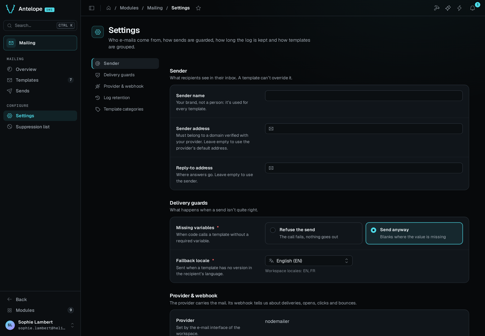

Mailing has one module option and a set of workspace settings edited in the dashboard.

## Module option

```typescript fragment [antelope.config.ts]
"dms-mailing": {
  source: { type: "package", package: "@antelopejs/dms-mailing", version: "^0.9.0" },
  config: {
    useHtmlRender: true,
  },
},
```

| Option | Type | Default | Description |
| --- | --- | --- | --- |
| `useHtmlRender` | `boolean` | `true` | Renders e-mails through the DMS html-render chain, with the DMS e-mail branding. `false` uses the module's own standalone HTML renderer. The module also falls back to that renderer when the DMS renderer fails, and logs `[dms-mailing] html-render unavailable, using fallback`. |

The webhook URL starts with the DMS `clientBaseUrl` from the `dms` module config. Without it, the URL starts with the DMS `apiBaseUrl`, and without that, with the origin of the API server itself. The e-mail logo comes from the DMS branding: `branding.logo.email.light`, else `branding.logo.default.light`. Only the html-render chain draws the logo.

## Workspace settings

Each workspace edits its settings on **Configure › Settings**. `GET /api/mailing/settings` reads them and `PUT /api/mailing/settings` writes them. A write carries only the changed fields.



| Section | Setting | Default | Description |
| --- | --- | --- | --- |
| Sender | Sender name | empty | Your brand, used for every template. It is used only with a sender address. |
| Sender | Sender address | empty (the provider's default) | Must belong to a domain verified with your provider. |
| Sender | Reply-to address | empty (the sender) | Where answers go. |
| Delivery guards | Missing variables | Send anyway | **Refuse the send** fails the call when a required variable is missing. **Send anyway** leaves blanks. A real send from the dashboard refuses a missing required variable whatever this setting says. |
| Delivery guards | Fallback locale | `en` | The locale sent when a template has no version in the recipient's language. |
| Provider & webhook | Provider | read-only | The name of the `interface-email` implementation. |
| Provider & webhook | Webhook URL | read-only | `<origin>/api/mailing/events/<provider>/<tenantId>`, to copy into your provider or relay. `<provider>` is the provider name in lower case, with each run of other characters turned into a hyphen, or `provider` when there is none. |
| Provider & webhook | Webhook secret | generated, 48 hexadecimal characters | Sent in the `x-mailing-webhook-secret` header. A secret you paste needs 32 to 120 characters. **Rotate** issues a new secret, and the old one stops working at once. |
| Provider & webhook | Webhook status | read-only | The last event received and the last refused call, with **Send a test event**. |
| Log retention | Keep sends for | 90 days | Between 1 day and 10 years (3,650 days). A daily job at 03:15 server time deletes older sends and their events. It never deletes templates. |
| Template categories | Categories | Orders, Account & access, Billing, Marketing, Forms | Group the template gallery. `marketing` can be renamed, not removed. |

::note
The write refuses any field it does not know, the read-only `webhookUrl` and `provider` among them. `categories` is an array of `{ id, label, icon }`, where `label` holds one text per language (`{ en: "Orders", fr: "Commandes" }`) and `icon` is a Phosphor icon name such as `i-ph-package`.
::
