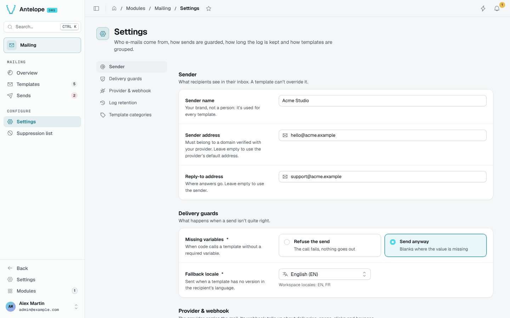

# Configuration

Mailing has one module option and a set of workspace settings edited in the dashboard.

## Module option

```typescript [antelope.config.ts]
"dms-mailing": {
  source: { type: "package", package: "@antelopejs/dms-mailing", version: "^0.6.0" },
  config: {
    useHtmlRender: true,
  },
},
```

| Option | Type | Default | Description |
| --- | --- | --- | --- |
| `useHtmlRender` | `boolean` | `true` | Renders e-mails through the DMS html-render chain, with the DMS e-mail branding. `false` uses the module's own standalone HTML renderer. The module also falls back to it when the frontend renderer is unreachable. |

The webhook URL is built on the DMS `clientBaseUrl` (`dms` module config), and the e-mail logo on the DMS branding's light logo.

## Workspace settings

Each workspace edits its settings on **Configure › Settings**. They are also readable and writable through `GET` and `PUT /api/mailing/settings` (send only the changed fields).



| Section | Setting | Default | Description |
| --- | --- | --- | --- |
| Sender | Sender name | empty | Your brand, used for every template. |
| Sender | Sender address | empty (the provider's default) | Must belong to a domain verified with your provider. |
| Sender | Reply-to address | empty (the sender) | Where answers go. |
| Delivery guards | Missing variables | Send anyway | **Refuse the send** fails the call when a required variable is missing; **Send anyway** leaves blanks. |
| Delivery guards | Fallback locale | `en` | The locale sent when a template has no version in the recipient's language. |
| Provider & webhook | Provider | read-only | The name of the `interface-email` implementation. |
| Provider & webhook | Webhook URL | read-only | `<clientBaseUrl>/api/mailing/events/<provider>/<tenantId>`, to copy into your provider or relay. |
| Provider & webhook | Webhook secret | generated | Sent in the `x-mailing-webhook-secret` header, 32 characters or more. **Rotate** invalidates the old one at once. |
| Log retention | Keep sends for | 90 days | Between 1 day and 10 years. A daily job deletes older sends and their events; templates are never deleted. |
| Template categories | Categories | Orders, Account & access, Billing, Marketing, Forms | Group the template gallery. `marketing` can be renamed, not removed. |

::note
A write carrying a read-only field (`webhookUrl`, `provider`) is refused. `categories` is an array of `{ id, label, icon }`.
::
