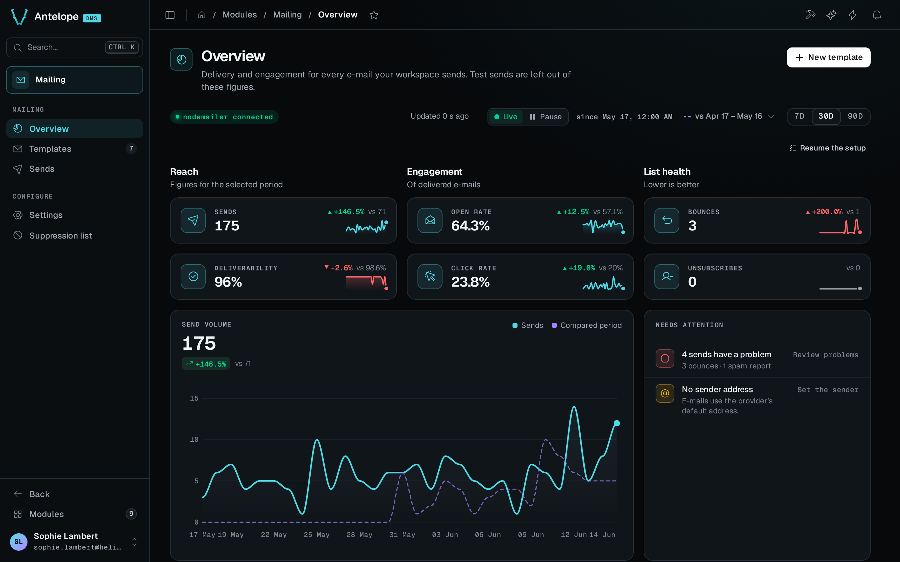
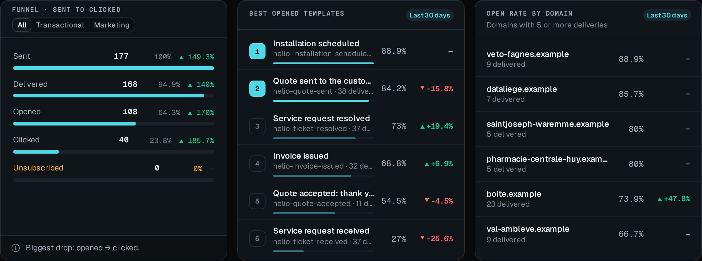

The Overview is the module's landing page. It shows whether your e-mails reach people over the selected period of 7, 30, or 90 days (30 by default), compared with the previous period by default. Test sends are left out of every figure, and so are sends to an address on the [suppression list](/docs/modules/mailing/usage/suppression-list), because they never left.

## Figures

| Group | KPI | Meaning |
| --- | --- | --- |
| Reach | Sends | E-mails sent in the period |
| Reach | Deliverability | Share of sends the provider reported as delivered |
| Engagement | Open rate | Share of delivered e-mails that were opened |
| Engagement | Click rate | Share of delivered e-mails that were clicked |
| List health | Bounces | Sends that bounced. Lower is better. |
| List health | Unsubscribes | Recipients who unsubscribed. Lower is better. |

Deliverability, open rate, and click rate show no value when nothing reports deliveries back, for example before the provider's webhook is set up.

The **Send volume** chart plots the sends per day. The compared period is drawn as a dashed series, aligned day by day with the selected period.

## Lower cards

- **Needs attention** lists what to act on. Each entry links to the next step with a verb, such as **Review problems**, which opens the Sends page on its **Problems** tab. The entries cover sends with a problem, live templates missing a locale that other live templates have, a missing sender address, deliveries or opens and clicks that nothing reports, a period that holds only test sends, live templates not sent in the period, and drafts never published and left untouched for over a week.
- **Funnel · sent to clicked** shows the steps sent, delivered, opened, clicked, and unsubscribed, each with its count and rate. A switch shows the funnel for **All** templates, for **Transactional** ones, or for the **Marketing** ones, which are the templates of the `marketing` category. The card names the biggest drop between two steps. While the toolbar compares, a last column gives each step's change against the compared period, and its tooltip gives the count in the compared period.
- **Best opened templates** ranks up to 10 templates by open rate, and **Open rate by domain** ranks up to 6 recipient domains. Both cover the selected period and rank only rows with 5 or more deliveries. Each row shows the change of its open rate against the compared period. A row that the compared period could not rank, because it had fewer than 5 deliveries there, shows no change.

## Toolbar

The page header holds the **New template** button. Under it, the toolbar shows whether a provider is connected, when the figures were last updated, the **Live** and **Pause** switch, the period, the comparison menu, and the **7D**, **30D**, and **90D** switch.

The comparison menu compares the figures with the period just before (**vs previous period**, the default), with the same dates a year earlier (**vs previous year**), or with nothing (**No comparison**). Every figure on the page follows it: the KPI changes, the dashed series of the volume chart, the change column of the funnel, and the changes in both rankings. **No comparison** removes them all. The **Needs attention** list is not a figure and never compares.

In **Live** mode, every figure, KPI cards included, refreshes as e-mails are sent and as the provider reports back, at most every 5 seconds. **Pause** freezes the figures and counts the new sends until you resume. The L key switches between the two modes. The Sends page shares the same choice.

## Setup checklist

Until a provider is connected and at least one template is live, the page shows a setup checklist instead of the figures. Its four steps are **Connect a provider**, **Set the sender**, **Publish a template**, and **Send yourself a test**. Once the figures show, **Resume the setup** reopens the checklist while a step is still open.
