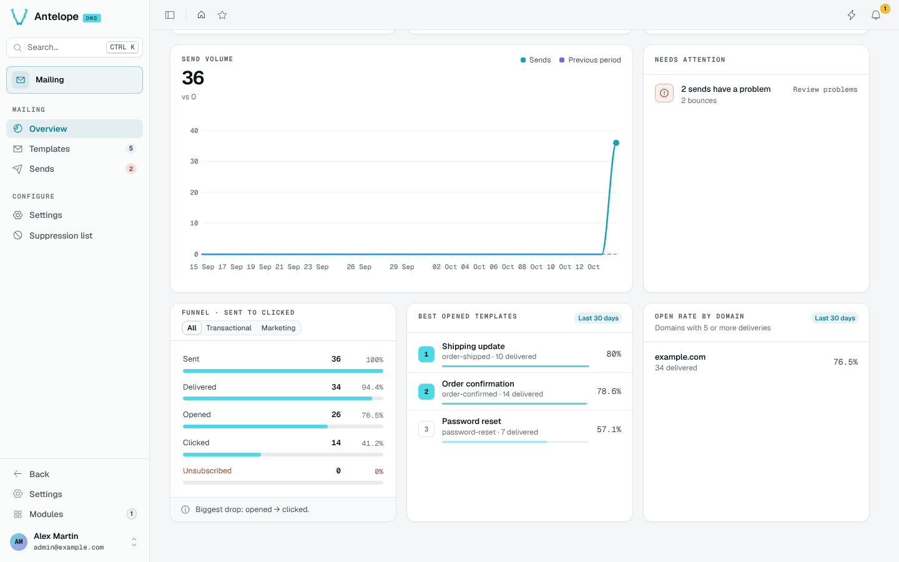

# Overview

The Overview is the module's landing page. It answers "are our e-mails reaching people?" for the selected period (7, 30 or 90 days), compared with the previous one. Test sends are left out of every figure.

## Figures

| Group | KPI | Meaning |
| --- | --- | --- |
| Reach | Sends | E-mails sent in the period |
| Reach | Deliverability | Share of sends the provider delivered |
| Engagement | Open rate | Share of delivered e-mails opened |
| Engagement | Click rate | Share of delivered e-mails clicked |
| List health | Bounces | Lower is better |
| List health | Unsubscribes | Lower is better |

The **Send volume** chart plots the sends per day against the previous period.

## Below the fold

- **Needs attention** lists what to act on (sends with a problem, templates missing a workspace locale), each with a verb such as **Review problems**, which opens the Sends page on its Problems tab.
- **Funnel · sent to clicked** shows each step with its count and rate, for all templates, transactional ones or the `marketing` category, and names the biggest drop.
- **Best opened templates** and **Open rate by domain** (domains with 5 or more deliveries) cover the last 30 days.

## Header

The header shows whether the provider is connected, the comparison period, the period switch and **New template**. Until the workspace has a provider and a template, the page shows a setup checklist instead; **Resume the setup** reopens it later.
