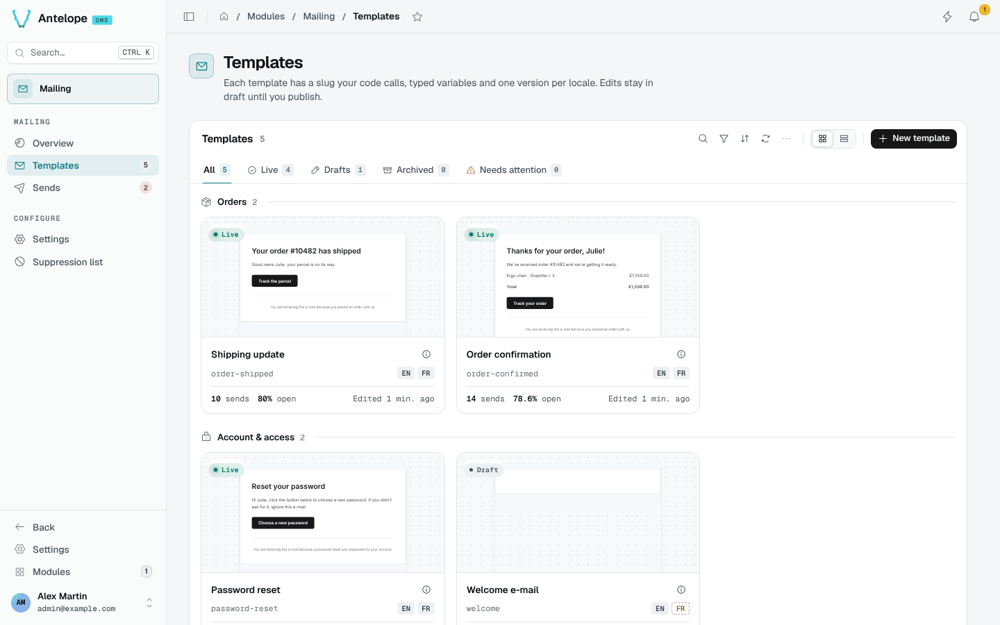
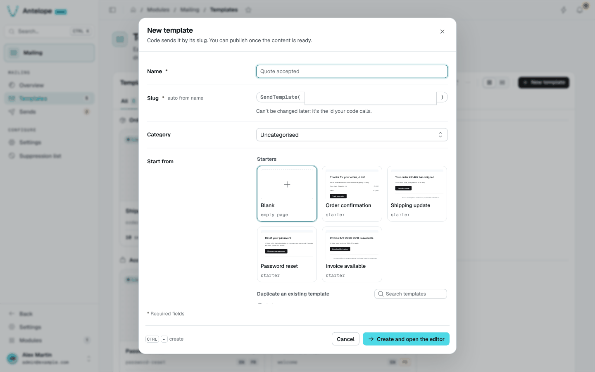

# Templates

A template has a **slug** your code calls, **typed variables**, and one version per **locale**. Open the gallery from **Mailing › Templates**.

## The gallery

Templates are grouped by category, each card showing a thumbnail of the e-mail, its status (Live, Draft, Archived), its slug, its locales (a dashed locale is missing), its sends and open rate over 30 days, and when it was last edited. Switch to the list view for a table.

The tabs filter by status: **All**, **Live**, **Drafts**, **Archived** and **Needs attention** (drafts, templates never sent, failing templates or templates missing a workspace locale).

## Create a template

**New template** asks a name, a slug (derived from the name, and fixed once created), a category and a starting point: a blank page, a starter, or a copy of an existing template.

`Ctrl Enter` creates the template and opens the [editor](/docs/modules/mailing/usage/editor).

## Template details

The info icon of a card opens the template's details: a preview with a locale switch, the variables it expects with a "Call it from code" snippet, and its performance over 30 days (sends, open rate, problems, and "Called from", the sends grouped by source). From there you can send a test, duplicate the template or open the editor. The lifecycle menu offers only the valid transitions: publish, unpublish, archive and restore.

**Send to real recipients** is offered on live templates only. Its dialog takes up to 5 addresses, shows a review (from, subject, version, data) and stays disabled until you tick the acknowledgement. A real send needs the `mailing.send` permission.

::note
**Duplicate** copies every locale, the variables and the test data into a new draft, with "(copy)" in the name and a derived slug.
::
