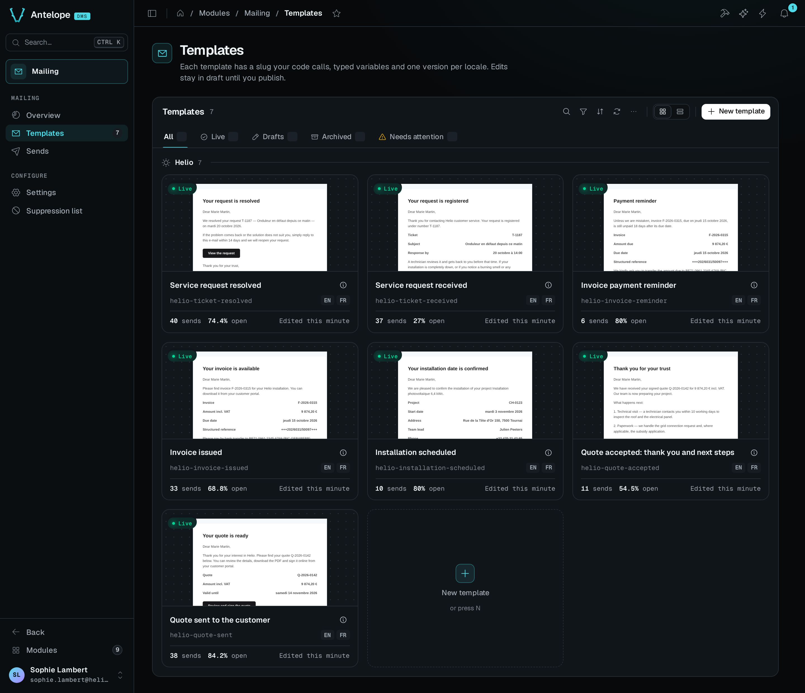
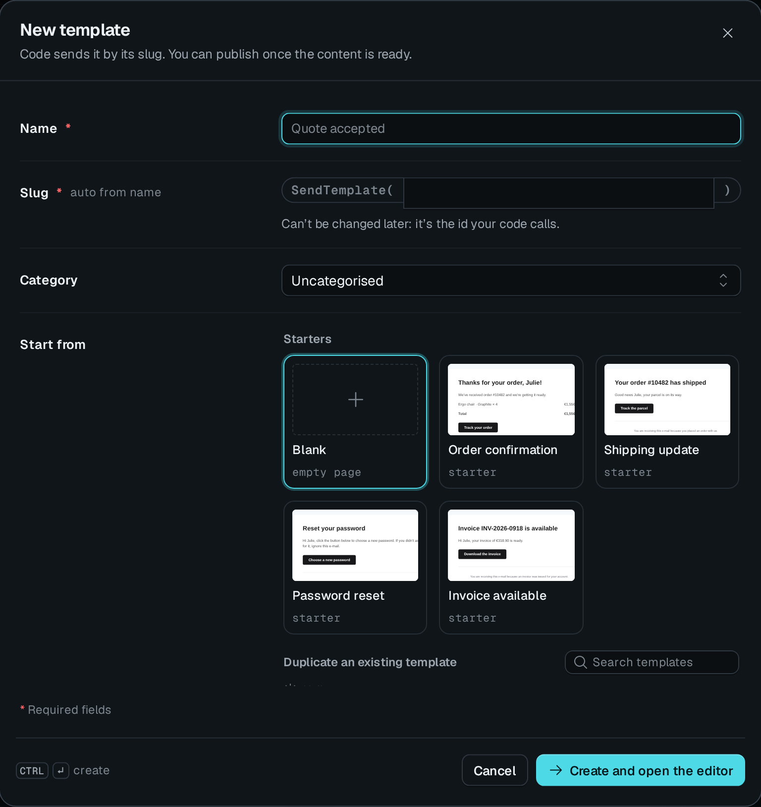

A template has a **slug** that your code calls, **typed variables**, and one version per **locale**. The gallery opens from **Mailing › Templates**.

## The gallery

The gallery groups templates by the categories declared in the [settings](/docs/modules/mailing/usage/settings), in their order, with the templates that have no category in a last group. Each card shows:

- a thumbnail of the e-mail, which renders as the card scrolls into view and reads *Preview unavailable* when it cannot be rendered,
- its status: **Live**, **Draft**, **Archived**, or **Draft changes** for a live template with unpublished edits,
- its slug and its locales, with a dashed chip for a workspace locale it lacks,
- its sends and open rate over the last 30 days or, without a send in that time, when it went live or was last edited.

The table display lists the same templates as rows.

The tabs filter the templates:

| Tab | Templates |
| --- | --- |
| **All** | Every template except the archived ones |
| **Live** | Live templates |
| **Drafts** | Draft templates |
| **Archived** | Archived templates |
| **Needs attention** | Drafts never published and left untouched for over a week, live templates with no real send in the last 30 days, and live templates missing a locale that another live template has |

## Create a template

**New template**, or the N key in the gallery, opens a dialog that asks for a name, a slug, a category, and a starting point. The slug is derived from the name, and it cannot change once the template exists. The starting point is a blank page, a starter, or a copy of an existing template.

Ctrl+Enter, or Cmd+Enter on macOS, creates the template and opens the [editor](/docs/modules/mailing/usage/editor).

## Template details

The info icon of a card opens the template's details in a drawer. Its tabs are:

- **Preview**, the e-mail with a locale switch,
- **Variables**, the variables the template expects, with a **Call it from code** snippet,
- **Performance**, over the last 30 days: sends, open rate, problems, locale fallbacks, and **Called from**, the sends grouped by source,
- **History**, the published versions, each of which can be restored as the draft.

The drawer footer has **Test**, **Duplicate**, and **Open the editor**. The **More actions** menu offers only the lifecycle moves that the template's status allows:

| Status | Moves |
| --- | --- |
| Draft | **Publish the draft**, **Archive** |
| Live | **Unpublish**, **Archive**, and **Publish the draft** when a draft waits |
| Archived | **Restore**, which brings the template back as a draft |

An unpublished or archived template refuses sends, so code that calls its slug gets an error. Only an archived template that was never sent can be deleted.

**Send to real recipients** is offered on live templates only. Its dialog takes up to 5 addresses and shows a review of the sender, the subject, the version, and the values for the send. The send button stays disabled until you tick the acknowledgement.

Test sends, real sends, and every send again need the `mailing.send` permission (**Send e-mails and tests**). Like every module permission, only the platform owner holds it. A workspace role that lists it does not open these actions to a member.

::note
**Duplicate** copies every locale, the variables, and the test data into a new draft. The name gets "(copy)" and the slug is derived from it. You can change both before you confirm.
::
