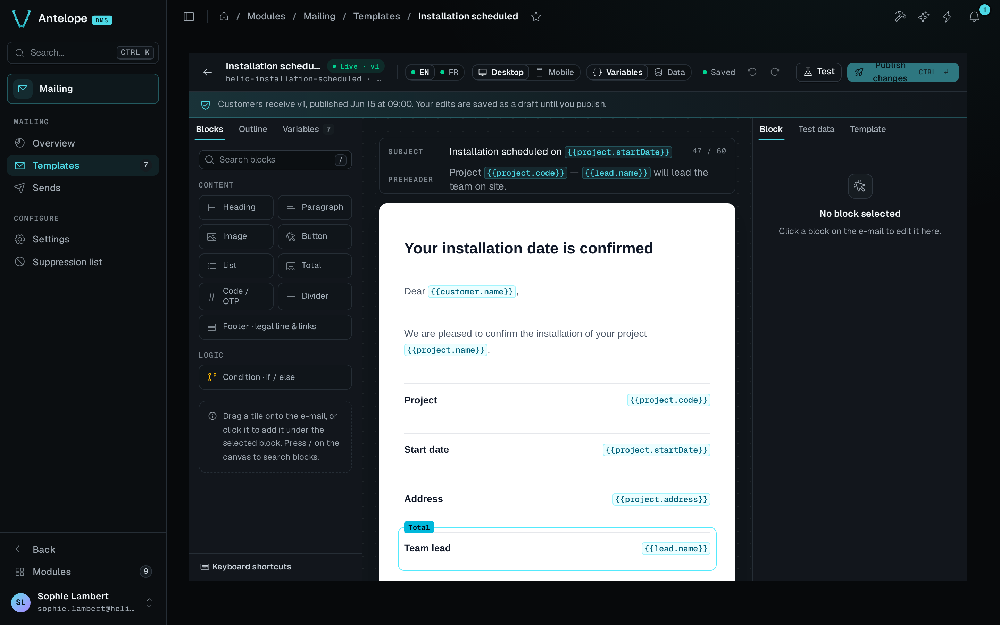
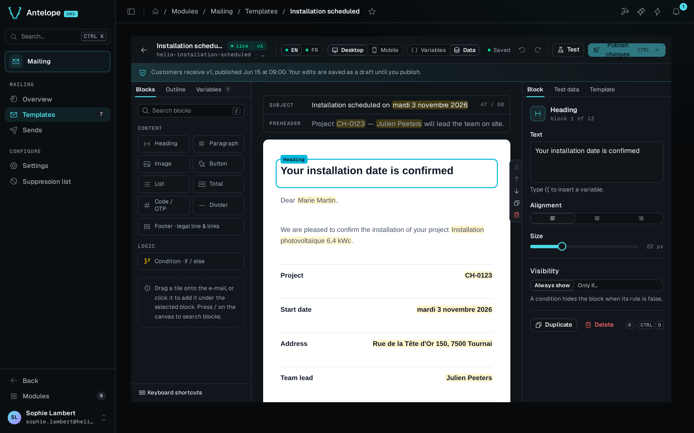

The editor is a three-pane page at `/modules/mailing/templates/<id>`. Its breadcrumb reads Mailing › Templates › *template name*.

## Layout

- **Left pane.** It has three tabs: **Blocks** to drag or click onto the e-mail, the **Outline** of the e-mail, and the **Variables** that the template declares. Its footer lists the keyboard shortcuts.
- **Canvas.** The subject and preheader rows sit above the e-mail, which has an insert point between each pair of blocks.
- **Right pane.** It has three tabs: **Block** for the selected block, **Test data**, and **Template** for the template's name, slug, category, subject and preheader, lifecycle, and version history.
- **Toolbar.** It holds the locale switch, where a dot marks a missing locale. Next come the **Desktop** and **Mobile** switch and the **Variables** and **Data** switch, which shows variables as tokens or as their test values. The save state with undo and redo, **Test**, and **Publish changes** sit on the right.

## Blocks

| Block | Use |
| --- | --- |
| Heading | Text with an alignment and a size |
| Paragraph | Text with an alignment |
| Image | An image with its alternative text |
| Button | A call to action with its link and alignment |
| List | One row per item of an array variable (`#each order.lines`), with a label path and a value path |
| Total | A label and a value, such as the order total |
| Code / OTP | A code to copy, such as a one-time password |
| Divider | A separator |
| Footer | The legal line, with optional unsubscribe and preferences links |
| Condition | An if and else group. The first branch shows when a rule on a variable holds, and the else branch shows otherwise. |

Every block also has a **Visibility** setting. **Always show** keeps the block in every e-mail. **Only if…** shows it only when a variable is filled in, is empty, equals a value, differs from a value, is greater than a value, or is lower than a value.

## Variables

Typing `{{` in a text field inserts a declared variable, such as `{{customer.firstName}}`. A variable has a type and can be required:

| Type | Label |
| --- | --- |
| `string` | Short text |
| `text` | Long text |
| `number` | Number |
| `money` | Amount |
| `date` | Date |
| `url` | Link |
| `boolean` | Yes / no |
| `array` | List |

The preview and the e-mails sent format an amount and a date for the recipient's locale, while **Data** mode shows them as written. An amount is written as `{ "value": 4800, "currency": "EUR" }`, with the value in the currency's smallest unit, so this one is 48 euros. A variable declared as `date` is written as an ISO string such as `"2026-11-14"`. The editor flags a path that the template uses but does not declare, and **Declare** adds it in one click.

The footer's unsubscribe and preferences links declare the `unsubscribeUrl` and `preferencesUrl` system variables. Your code passes them at send time. They are required for a template in the `marketing` category. A link whose URL is missing is left out of the e-mail.

## Draft, test, publish

The draft saves itself as you edit. A notice says which published version customers receive, and **Discard draft** drops your changes and goes back to that version.

- **Test** sends the draft to up to 5 addresses, with your own address filled in by default, in the chosen locale and with the test data. The subject starts with `[TEST]` and the send stays out of the figures.
- **Publish changes** lists the changes and the checks to look at, then creates the next version. A locale with an empty subject stops the publish. Real sends always use the published version.
- The version history in the **Template** tab restores an earlier version into the draft. Customers keep the live version until you publish again.

::tip
When the selected locale has no version, the empty canvas says how many recipients asked for it in the last 30 days and got the fallback locale. It offers to duplicate the fallback locale or to start from an empty page.
::

## Keyboard shortcuts

On macOS, Cmd replaces Ctrl.

| Shortcut | Action |
| --- | --- |
| `Ctrl S` | Save the draft now |
| `Ctrl Enter` | Publish |
| `T` | Send a test |
| `/` | Search blocks |
| `Backspace` or `Delete` | Delete the selected block |
| `Ctrl D` | Duplicate the selected block |
| `Ctrl Z` | Undo |
| `Ctrl Shift Z` or `Ctrl Y` | Redo |
| `Escape` | Deselect, then go back to Templates |
