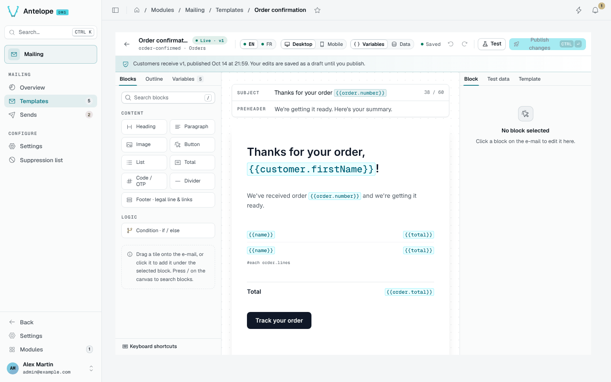
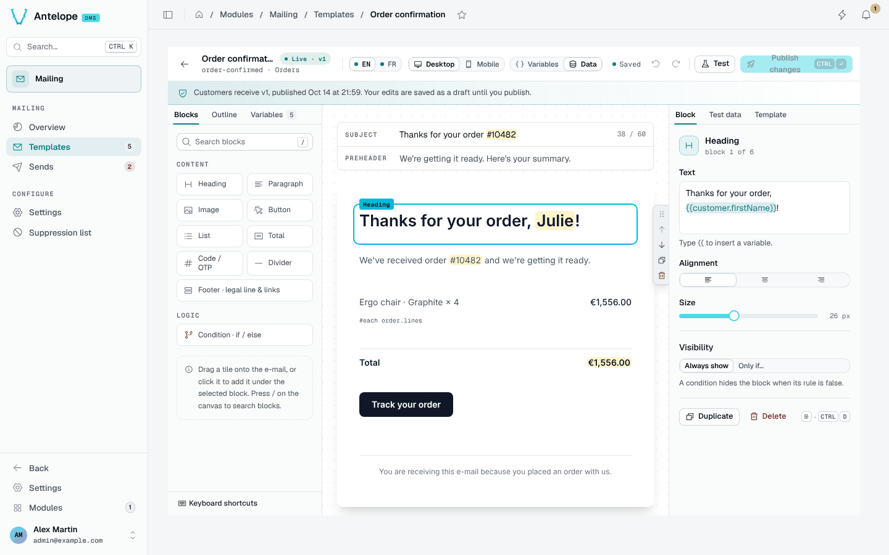

# Editor

The editor is a three-pane page at `/modules/mailing/templates/<id>`. The breadcrumb reads Mailing › Templates › *template name*.

## Layout

- **Left**: **Blocks** to drag or click onto the e-mail, the **Outline** of the e-mail, and the **Variables** the template declares.
- **Centre**: the subject and preheader rows, then the e-mail with insert points between blocks.
- **Right**: the inspector of the selected **Block**, the **Test data**, and the **Template** properties.
- **Toolbar**: locale switch (a dot marks a missing locale), Desktop / Mobile, **Variables** | **Data** to show tokens or the test data, save state, undo and redo, **Test** and **Publish changes**.

## Blocks

| Block | Use |
| --- | --- |
| Heading, Paragraph | Text with alignment (and size for headings) |
| Image | A hero image with its alternative text |
| Button | A call to action with its link |
| List | One row per item of an array variable (`#each order.lines`), with a label and a value path |
| Total | A label and a value, such as the order total |
| Code / OTP | A code to copy, such as a one-time password |
| Divider | A separator |
| Footer | The legal line, and optional unsubscribe and preferences links |
| Condition | An if / else group shown when a rule on a variable holds |

Every block also has a **Visibility** rule: always shown, or only if a variable is truthy, falsy, equal, different, greater or lower than a value.

## Variables

Type `{{` in a text field to insert a declared variable, such as `{{customer.firstName}}`. Variables have a type (`string`, `text`, `number`, `money`, `date`, `url`, `boolean`, `array`) and can be required. In Data mode, a test amount written as `{ "value": 4800, "currency": "EUR" }` and a `date` written as `"2026-11-14"` show as the recipient will read them, in the locale you are editing. An undeclared path is flagged, with a one-click **Declare**.

The footer's unsubscribe and preferences links declare the `unsubscribeUrl` and `preferencesUrl` system variables, required in the `marketing` category. Your code passes them at send time; a link without its URL is left out.

## Draft, test, publish

The draft autosaves. A notice reminds you which version customers receive; **Discard draft** drops your changes.

- **Test** sends the draft to up to 5 addresses (yourself by default), in a locale, with the test data. The subject starts with `[TEST]` and the send stays out of the figures.
- **Publish changes** reviews the changes per locale and the failed checks, then creates the next version. Real sends always use the published version.
- The version history restores an earlier version into the draft.

::tip
When a locale is missing, the empty canvas counts the recipients who got the fallback over 30 days, and offers to duplicate the fallback locale or start from an empty page.
::

## Keyboard shortcuts

| Shortcut | Action |
| --- | --- |
| `⌘ S` / `Ctrl S` | Save the draft now |
| `⌘ Enter` / `Ctrl Enter` | Publish |
| `T` | Send a test |
| `/` | Search blocks |
| `Backspace` | Delete the selected block |
| `⌘ D` / `Ctrl D` | Duplicate the selected block |
| `⌘ Z`, `⌘ Shift Z` | Undo, redo |
| `Escape` | Deselect, then back to Templates |
