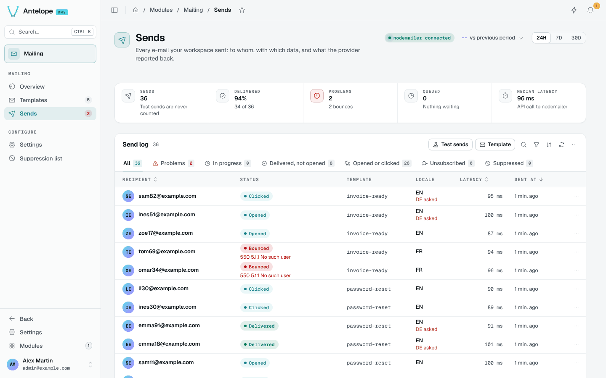
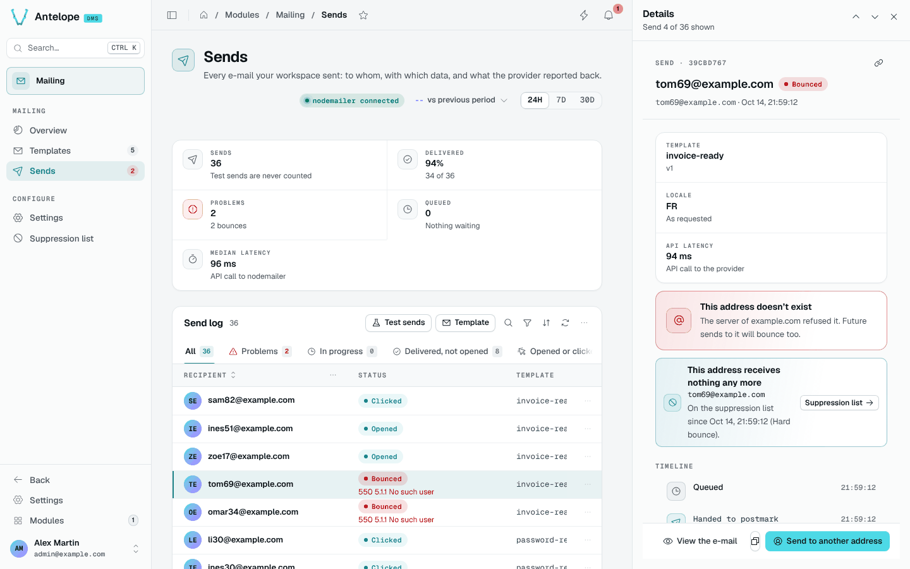

# Sends

The send log lists every e-mail of the workspace: to whom, with which data, in which locale, and what the provider reported back. Open it from **Mailing › Sends**; its sidebar badge counts the sends with a problem.

## Stat strip and tabs

The stat strip covers the selected period (24 hours by default, 7 or 30 days): sends (tests never count), delivered, problems, queued and the median latency of the provider call.

The tabs follow each send's stage: **All**, **Problems**, **In progress**, **Delivered, not opened**, **Opened or clicked**, **Unsubscribed** and **Suppressed**. The **Test sends** and **Template** filters narrow the list.

The **Locale** column shows the locale sent; when it differs from the one asked for, it says so (`DE asked`), so fallbacks are visible.

## Send details

Click a row to open its details in a drawer on the right, over the log. Drag its left edge to widen it: the timeline and the origin then sit side by side, and the drawer opens again at that width. **J** / **K** step through the sends shown, the URL keeps the open send so the link can be shared, and **Esc** or a click beside the drawer closes it.

- **Origin**: the template and its version, the locale and the API latency.
- **Problem banner**: what went wrong in plain words ("This address doesn't exist"), and whether the address is now on the suppression list.
- **Timeline**: queued, handed to the provider, delivered, opened, clicked, with the provider's raw answer.
- **Data** sent, with Copy JSON, and **View the e-mail**, re-rendered from the stored version and data.

The footer adapts to the status: **Send to another address** after a bounce or a spam report, **Send again…** after a provider failure (confirmed with the recipient, the version and the last error).

## Provider problems

When the provider cannot be reached, or provider failures piled up in the last hour, a banner above the log links to the provider settings and offers to send those failures again. Bounces are never resent this way.
