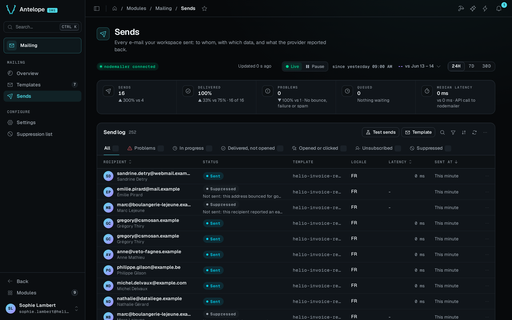
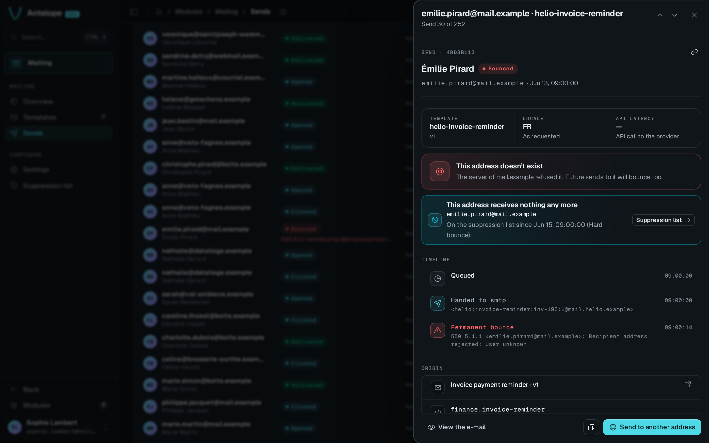

The send log lists every e-mail of the workspace: the recipient, the data, the locale, and what the provider reported back. It opens from **Mailing › Sends**. Its sidebar badge counts the real sends with a problem in the last 24 hours.

## Toolbar

The toolbar shows whether a provider is connected, when the log was last updated, and the **Live** and **Pause** switch. It also holds the period, **24H** by default, **7D**, or **30D**, with its comparison menu. The menu compares the stat strip with the previous period, with the same dates a year earlier, or with nothing. The log is a list and never compares.

In **Live** mode, new sends and provider events appear as they come, at most every 5 seconds. The table holds its rows while a send is open in the drawer, while you have scrolled down the log, and while a search narrows it. A "N new sends" strip counts what arrived meanwhile, and **Show** adds those rows. **Pause** holds the whole page the same way. The Overview shares the same choice.

## Stat strip and tabs

The stat strip covers the selected period:

| Figure | What it shows |
| --- | --- |
| Sends | Real sends. Test sends never count. |
| Delivered | The share of sends delivered, with the count |
| Problems | Bounces, provider failures, and spam reports |
| Queued | The sends waiting now, with the oldest wait |
| Median latency | The median time of the API call to the provider |

While the toolbar compares, every figure except **Queued** states its change and the compared figure, as in `▲ 25 % vs 16`. **Queued** is what waits now, so it is never compared.

The tabs follow each send's stage: **All**, **Problems**, **In progress**, **Delivered, not opened**, **Opened or clicked**, **Unsubscribed**, and **Suppressed**. The **Problems** tab leaves test sends out. The **Test sends** and **Template** filters narrow the list.

The **Locale** column shows the locale sent. When it differs from the locale asked for, the column says so (`DE asked`), so fallbacks are visible.

## Send details

A click on a row opens its details in a drawer on the right, over the log. The drawer is headed by its recipient and template, and by its position in the log ("Send 3 of 1,348"). Dragging its left edge widens it, and a wide drawer puts the timeline and the origin side by side. The drawer opens again at the width you gave it. J and K step through every send the log lists, across its pages. The URL keeps the open send, so you can share the link. Escape, or a click beside the drawer, closes it.

- **Problem banner.** It says what went wrong in plain words, such as "This address doesn't exist", and whether the address is now on the suppression list.
- **Timeline.** It lists the steps: queued, handed to the provider, delivered, opened, and clicked, with the provider's raw answer.
- **Origin.** It shows the template and its version, the locale, and the API latency.
- **Data sent.** It shows the variables of the send, with **Copy JSON**. **View the e-mail** renders the e-mail again from the stored version and data.

The drawer footer depends on the status:

| Status | Footer actions |
| --- | --- |
| Permanent bounce | **View the e-mail**, copy the address, **Send to another address** |
| Temporary bounce or provider failure | **View the e-mail**, **Send again…**, confirmed with the recipient, the version, and the last error |
| Spam, unsubscribed, or suppressed | **View the e-mail**, copy the address |
| Already sent again | **View the e-mail**, copy the address |
| Any other status | **Send again…**, **View the e-mail** |

A suppressed send whose address was reactivated since offers **Send again…**.

## Provider problems

A banner above the log appears when no provider is connected, when the provider cannot be reached, or when provider failures pile up in the last hour. Failures pile up when any of them is a connection failure, or when there are 3 or more and they make up at least 10% of the hour's real sends. The banner links to the provider settings. When the hour holds provider failures that can go again, it also offers **Send the failures again…**, which sends up to 100 of them again with the same version and data. Bounces, spam reports, test sends, and failures to an address on the suppression list are never part of it.
