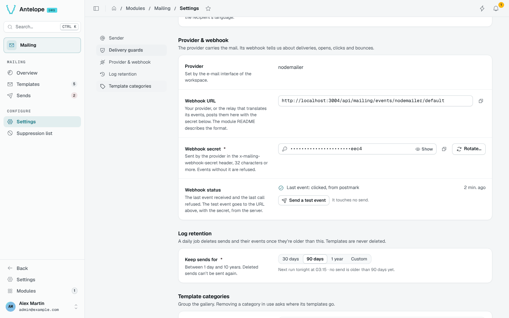

# Settings

**Configure › Settings** holds the workspace's mailing settings, in five sections with a side navigation. Changes are saved with the save bar. The [Configuration](/docs/modules/mailing/configuration#workspace-settings) page lists every setting and its default.

## Provider & webhook

- **Webhook URL**: copy it into your provider, or into the relay that translates its events. See the [webhook contract](/docs/modules/mailing/extending#webhook-contract).
- **Webhook secret**: **Show**, copy, or **Rotate…** it. Rotating invalidates the old secret at once.
- **Webhook status**: the last event received (when, its type, the provider label, whether it matched a send) and the last call refused, with its reason. **Send a test event** posts a test event to the URL from the server, with the stored secret: it proves the URL is reachable and touches no send.

## Log retention

Choose 30 days, 90 days, 1 year or a custom duration. The section shows when the next run happens and how many sends it will delete.

## Template categories

Drag to reorder the gallery's categories, rename them or add new ones. Removing a category in use asks where its templates go. The `marketing` category can be renamed, not removed: the footer link rules depend on it.
