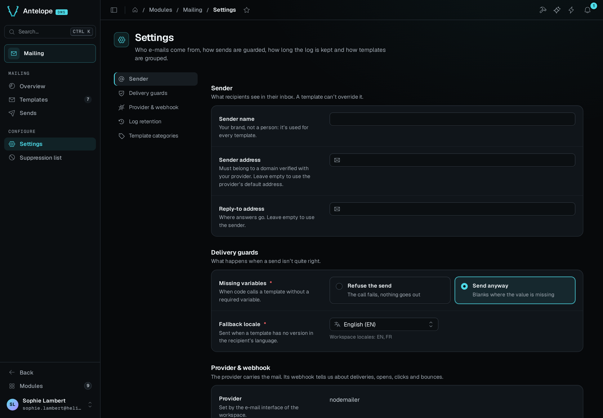
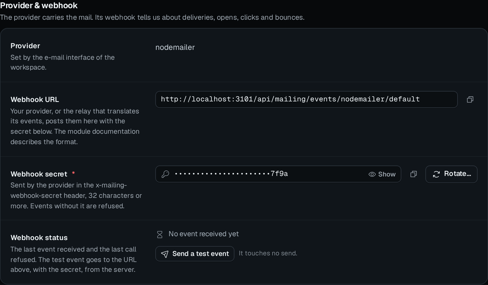

**Configure › Settings** holds the workspace's mailing settings in five sections, with a side navigation between them. The save bar saves your changes. The [Configuration](/docs/modules/mailing/configuration#workspace-settings) page lists every setting and its default.

## Sender

- **Sender name.** The name recipients see, used for every template. It applies only together with a sender address.
- **Sender address.** It must belong to a domain verified with your provider. When it is empty, e-mails use the provider's default address.
- **Reply-to address.** Where answers go. When it is empty, answers go to the sender.

A template cannot override the sender.

## Delivery guards

- **Missing variables.** What happens when code calls a template without a required variable: **Refuse the send**, so the call fails and nothing goes out, or **Send anyway**, with blanks where the value is missing.
- **Fallback locale.** The locale sent when a template has no version in the recipient's language. It is one of the workspace locales.

## Provider & webhook

- **Provider.** The provider that the workspace's e-mail interface uses. It is read-only here.
- **Webhook URL.** Copy it into your provider, or into the relay that translates its events. See the [webhook contract](/docs/modules/mailing/extending#webhook-contract).
- **Webhook secret.** The provider sends it in the `x-mailing-webhook-secret` header, and it has at least 32 characters. **Show** reveals it, and **Rotate…** replaces it with a new one once you confirm. The old secret stops working at once.
- **Webhook status.** It shows the last event received, with its time, its type, the provider, and whether it matched a send. It also shows the last refused call and its reason. **Send a test event** posts a test event to the URL from the server, with the stored secret. It proves that the URL is reachable and touches no send.

## Log retention

**Keep sends for** offers 30 days, 90 days, 1 year, or a custom duration between 1 day and 10 years. A daily job deletes the sends and their events once they are older than this, and it never deletes templates. The section shows when the next run happens and how many sends it will delete. A shorter duration that deletes sends asks for confirmation, because a deleted send cannot be sent again.

## Template categories

The categories group the template gallery. You can drag them, or use the arrow keys, to reorder them, rename them, change their icon, and add new ones. Removing a category that templates use asks where those templates go: another category or no category. The `marketing` category can be renamed but not removed, because the footer link rules and the funnel's **Marketing** split depend on it.
