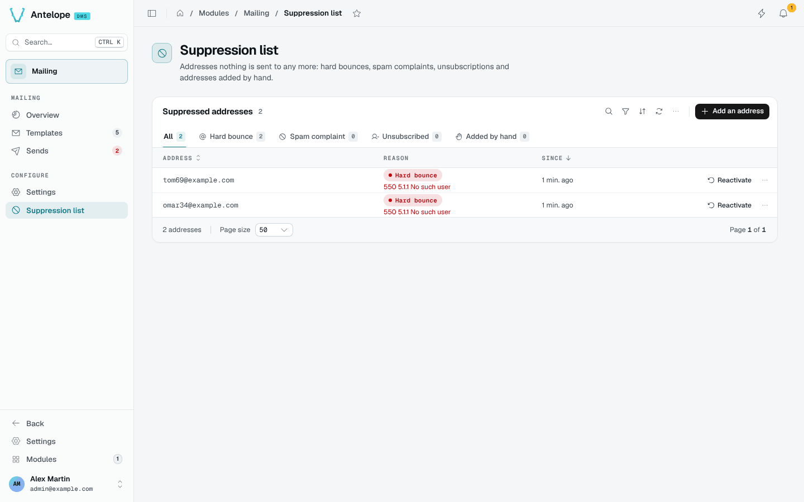

# Suppression list

An address on the suppression list receives no e-mail from the workspace. Open it from **Configure › Suppression list**.

## How an address gets on the list

- The provider reports a **permanent bounce**: a `bounced` event that is not temporary (no `4xx` / `4.x.x` answer, no `soft` bounce type).
- The provider reports a **spam complaint** (`spam`) or an **unsubscription** (`unsubscribed`).
- Someone adds it **by hand**, with an optional note.

A test send only adds its address on a permanent bounce: a spam report or an unsubscription on a test is the editor's own gesture.

## What a suppressed address gets

Every send path checks the list: `SendTemplate`, the automation action, the real send dialog, **Send again** and **Send to another address**. A suppressed recipient is logged with the status `suppressed` (the Sends page has a tab for them, and the figures leave them out), and nothing reaches the provider.

A test send to your own address still goes out, with a warning; a test to any other suppressed address does not.

## Manage the list

The tabs filter by reason: hard bounce, spam complaint, unsubscribed, added by hand. **Add an address** puts one on the list; **Reactivate** lifts it, and the next send reaches it again.

The same operations are available over HTTP: `POST /api/mailing/suppressions` with `{ "email", "note"? }` (`409` when the address is already listed) and `DELETE /api/mailing/suppressions/:id`. The workspace data export carries the list as `suppressions.json`.
