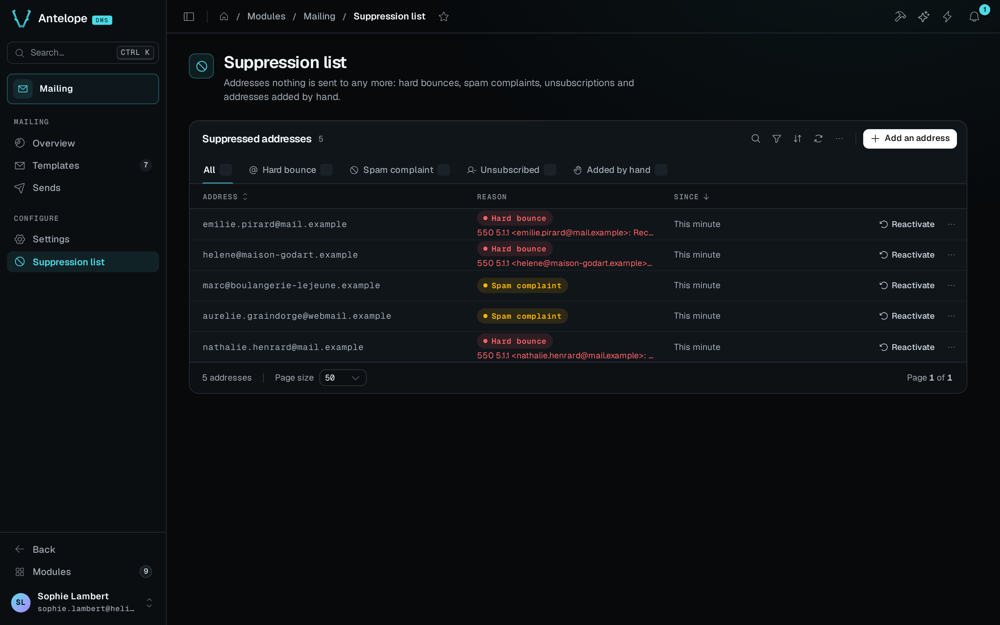

An address on the suppression list receives no e-mail from the workspace. The list opens from **Configure › Suppression list**.

## How an address gets on the list

- The provider reports a **permanent bounce**. A `bounced` event is temporary, and adds nothing, when its bounce type says soft, transient, or temporary. Without a hard or permanent bounce type, it is also temporary when the provider's answer is a `4xx` or `4.x.x` code.
- The provider reports a **spam complaint** (`spam`) or an **unsubscription** (`unsubscribed`).
- Someone adds it **by hand**, with an optional note of up to 500 characters.

An address already on the list keeps its first reason. A test send adds its address only on a permanent bounce, because a spam report or an unsubscription on a test is the editor's own action.

## What a suppressed address gets

Every send path checks the list: `SendTemplate`, the automation action, the test and real send dialogs, **Send again…**, and **Send to another address**. A send to a suppressed address is logged with the status `suppressed` and nothing reaches the provider. The Sends page has a **Suppressed** tab for these sends, and the figures leave them out.

A test send to your own address still goes out, with a warning. A test to any other suppressed address does not.

## Manage the list

The tabs filter by reason: **All**, **Hard bounce**, **Spam complaint**, **Unsubscribed**, and **Added by hand**. **Add an address** puts an address on the list. **Reactivate** takes it off, and the next send reaches it again. **See the send** opens the send that put the address on the list.

The same operations are available over HTTP:

| Request | Effect |
| --- | --- |
| `POST /api/mailing/suppressions` with `{ "email", "note"? }` | Adds the address. Answers `409` when the address is already on the list. |
| `DELETE /api/mailing/suppressions/:id` | Removes the entry. Answers `404` when it is no longer on the list. |

The workspace data export carries the list as `suppressions.json`.
